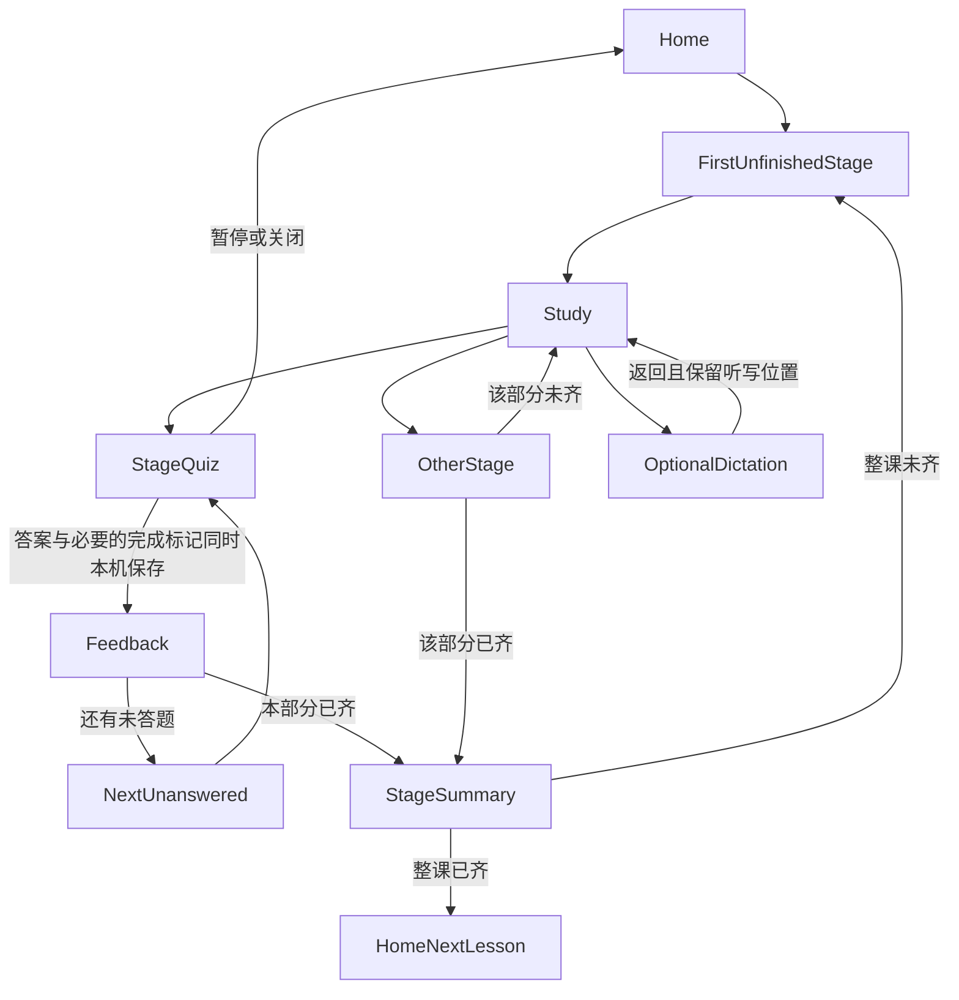

# 学习进度分支与回归场景

完成规则：三个部分的正式练习全部提交即完成整课；不要求全对。浏览内容、选做听写和错题复习各自记录，不伪造成正式答题。已有历史完成记录持续有效。账号以当前受邀注册者的用户 ID 为准。

| 情况 | 预期与修复 |
| --- | --- |
| 直接跳到课文，只答完最后5题 | 保留5题；展示整课5/30、缺少的两个部分；引导未完成部分 |
| 已答完某部分，再点开始 | 展示完成情况，不自动从第1题重做；主动重练另有入口 |
| 部分题目已在另一设备做过 | 按已保存题目跳过；从第一道未答题继续 |
| 暂停缓存比云端记录旧 | 当前记录优先；不复用已提交题目的旧暂停位置 |
| 提交整课最后一题，未点“完成”就离开 | 最后答案与完成标记在同一次本机写入中保存 |
| 历史记录题目已齐，但缺少完成标记 | 从真实答案重建完成标记；不编造缺失答案 |
| 内容扩充、题目版本或ID更新 | 原完成状态及原复习起点保留，新内容可选补练 |
| 老师当天安排了已完成课程 | 首页推荐下一门未完成课，避免当天安排反复锁回原课 |
| 上传过程中提交新答案 | 当前同步后紧接着上传新记录，不依赖下一次5秒轮询 |
| 同步进行中再次点击完整同步 | 排队执行完整拉取，不吞掉强制同步要求 |
| 断网或上传成功但响应丢失 | UUID重试，未确认记录留在待上传列表，不重复计数 |
| 205条记录中第一批成功、第二批失败 | 只确认成功批次；其余105条在恢复网络后重传 |
| 上传成功、拉取失败 | 已确认上传仍保留本机；拉取失败不回滚课程进度 |
| 两设备分别完成不同部分 | 合并不可变答题记录；从合并后的完整证据生成完成标记 |
| 云端超过1000条记录，或低序号事务迟到 | 分页拉取；启动、手动及定期完整校对补齐迟到记录 |
| 登录过期、退出或切换账号 | 原账号待上传记录不删除；停止的同步不应用迟到响应 |
| 本机存储写入失败 | 不显示已提交，不产生半条完成状态；提示重试 |
| 后台、刷新或关闭页面 | 切换前后台尝试同步；未上传记录保留，重开后补传；云端确认前明确显示待同步 |

验证：纯逻辑与接口契约回归测试，以及隔离的本机试用页面测试“只完成课文”“最后一题提交后立即关闭并刷新”“缺完成标记恢复”。正式账号只读核查，不写入测试答题记录。
